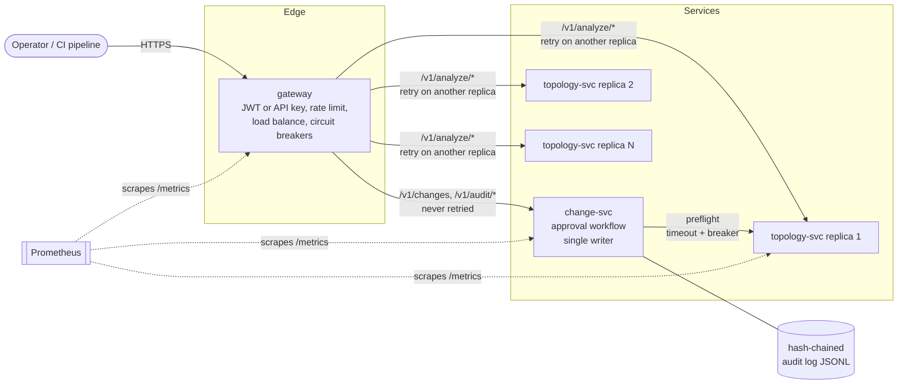
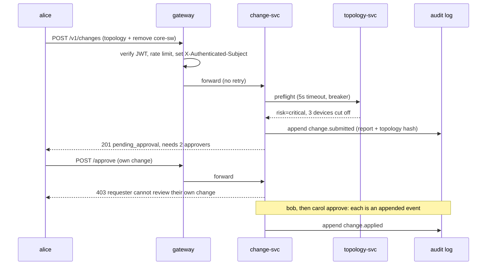

# Architecture

NetOrchestrator is a small set of independently deployable services around one idea:
**no network change is approved without first computing its blast radius, and every
decision is recorded in a tamper-evident log.**

## Services

| Service | Responsibility | State | How it scales | When it fails |
|---|---|---|---|---|
| **gateway** | Authenticate (HS256 JWT or hashed API key), per-subject rate limit (token bucket or sliding window, plus a stricter per-route budget, [ADR-0006](docs/adr/0006-rate-limiting.md)) with `RateLimit-*`/`Retry-After` headers, route by prefix, round-robin with a circuit breaker per replica, bounded retry **only** for idempotent routes | none | horizontally (stateless) | `/readyz` goes unready only if *every* replica of some route is circuit-open |
| **topology-svc** | Pure analysis: preflight (what gets cut off), resilience (single points of failure), shortest path. The topology is sent **in the request**, so replicas share nothing | none (per-replica LRU cache) | horizontally; HPA on CPU | sheds load with `429 + Retry-After` instead of queueing without bound |
| **change-svc** | Change requests: preflight, approval policy (four-eyes, 2 approvers when risk is critical), cancel/apply, audit endpoints | event log (JSONL) | **single writer by design** ([ADR-0004](docs/adr/0004-single-writer-change-svc.md)) | refuses to start if the audit log fails verification; `/readyz` re-verifies the chain |
| **platform** (library) | metrics, request IDs, access logs, breaker, JWT verify, graceful shutdown | n/a | n/a | n/a |
| **ratelimit** (library) | token bucket + sliding-window counter, sharded, injectable clock, exact `Retry-After` | per-replica memory | n/a | n/a |

## A change request, end to end

## Why the design looks like this

- **Stateless analysis, state in the request** ([ADR-0001](docs/adr/0001-stateless-analysis-service.md)). Replicas need no coordination, caching is a pure function of the request body, and any replica can serve any request.
- **Event-sourced, hash-chained audit** ([ADR-0002](docs/adr/0002-event-sourced-audit-log.md)). Current state is a fold over events, so "why was this approved, based on what?" is always answerable: the preflight report and a SHA-256 of the exact topology are inside the `change.submitted` event.
- **Stdlib-only platform layer** ([ADR-0003](docs/adr/0003-stdlib-platform-layer.md)). Small static binaries, no dependency surface for the security-critical path, everything unit-testable with the race detector.
- **Retry policy follows idempotency** ([ADR-0005](docs/adr/0005-retry-only-idempotent.md)). A pure analysis call may be retried on another replica; a state-changing call is never replayed.

## Failure behaviour (each row is covered by an automated test unless noted)

| Event | Behaviour |
|---|---|
| A topology-svc replica dies mid-traffic | gateway retries on another replica; after 5 consecutive failures its breaker opens and it stops being hit. Load test killed a replica during a run: 0 failed requests of 15,395 |
| All topology-svc replicas down | gateway returns `503 + Retry-After`; `/readyz` goes unready |
| topology-svc overloaded | `429 + Retry-After` (bounded in-flight work), no unbounded queue |
| topology-svc down while change-svc needs preflight | change-svc breaker opens, API returns retryable `503`, nothing is written to the log |
| Someone edits/deletes/reorders audit events | `/v1/audit/verify` returns 409; on restart the service **refuses to start** (checked with the real binary) |
| Log truncated at the tail | **not detectable by the chain alone**: anchor `head_hash` externally (documented limitation) |
| One user floods the API | that subject gets `429` with an exact `Retry-After`; other users are unaffected; state-changing routes have their own, stricter budget |
| Forged `alg=none` / tampered / expired JWT, forged API key | rejected at the gateway; never reaches a backend |
| Client sends its own `X-Authenticated-Subject` | dropped; the gateway asserts identity itself |
| Two approvers act at the same instant | decision and append happen under one lock; no double counting (race-tested) |

## Trust boundaries

- Only the **gateway** is exposed. `change-svc` trusts the identity header and `topology-svc` has no auth, so network policy must restrict them to the gateway (provided in `deploy/k8s/networkpolicy.yaml`).
- Secrets: the gateway refuses to start with a JWT secret shorter than 32 bytes; no default secrets exist.
- Containers: distroless, non-root, read-only root filesystem, all capabilities dropped.

## Observability

Each service exposes `/metrics` (Prometheus text format), `/healthz`, `/readyz`, JSON access logs with a propagated `X-Request-ID`. Metrics: `http_requests_total`, `http_request_duration_seconds` (histogram), `http_in_flight`, `topology_cache_total`, `topology_shed_total`, `gateway_upstream_total`, `gateway_rate_limited_total`, `gateway_route_rate_limited_total`, `gateway_auth_failures_total`, `gateway_unavailable_total`. SLOs and alert rules: [`docs/SLO.md`](docs/SLO.md), [`deploy/prometheus/alerts.yml`](deploy/prometheus/alerts.yml).
