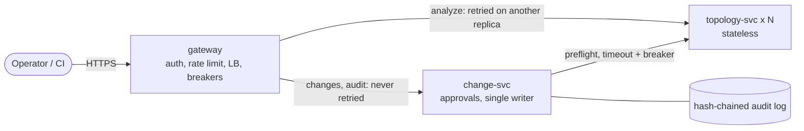

# NetOrchestrator

[](https://github.com/KritikaTri/netorchestrator/actions/workflows/ci.yml)

**Safe network change management as a set of small Go services.** Before a change touches a device,
NetOrchestrator computes what it would cut off, requires the right number of independent approvals, and
records every decision in a tamper-evident audit log.

```
$ make demo-services
1) alice proposes taking down core-sw          -> risk "critical": a1, a2, a3 lose connectivity, needs 2 approvers
2) alice tries to approve her own change       -> 403 requester cannot review their own change
3) bob approves                                -> still pending (critical risk needs two reviewers)
4) apply before quorum                         -> 409 not in a state that allows this action
5) carol approves, then apply                  -> applied
6) audit chain verification                    -> {"ok":true,"events":4,"head_hash":"..."}
7) request without a token                     -> 401 at the gateway
```

**Live demo:** https://34-93-232-226.sslip.io has a read-only playground (pick a device in a sample campus network and see what taking it down would cut off). The full API needs a token; `make demo-services` runs the whole workflow locally.

## Architecture



| Service | Role | Scales by |
|---|---|---|
| `gateway` | JWT/API-key auth, per-subject rate limits (token bucket or sliding window, stricter on state-changing routes, `RateLimit-*` headers), round-robin + per-replica circuit breakers, retry only for idempotent routes | stateless replicas |
| `topology-svc` | preflight, single-point-of-failure analysis, shortest path; topology is sent in the request, LRU cache, 429 load shedding | stateless replicas (HPA) |
| `change-svc` | change requests, risk-scaled approval policy, event-sourced hash-chained audit log | single writer by design ([ADR-0004](docs/adr/0004-single-writer-change-svc.md)) |
| `internal/platform` | stdlib-only metrics, request IDs, breaker, JWT verify, graceful shutdown | n/a |
| `internal/ratelimit` | token bucket + sliding-window counter behind one interface; exact `Retry-After`; deterministic tests ([ADR-0006](docs/adr/0006-rate-limiting.md)) | n/a |

Full design, failure-behaviour table and trust boundaries: [`ARCHITECTURE.md`](ARCHITECTURE.md). Decisions and their trade-offs: [`docs/adr/`](docs/adr). SLOs and alerts: [`docs/SLO.md`](docs/SLO.md).

## What is verified, and how

| Area | Evidence |
|---|---|
| Algorithms (`topology`, `cfgdiff`, `preflight`) | Dijkstra vs Floyd–Warshall and cut-vertex/bridge vs brute-force oracles on random graphs; preflight 93 % coverage |
| Services (`platform`, `gateway`, `topologysvc`, `changesvc`, `ratelimit`) | unit + HTTP tests under `-race`; coverage 86 % / 94 % / 91 % / 86 % / 96 % |
| Rate limiting | fake-clock tests: burst + steady rate, no boundary burst, `Retry-After` sufficient *and* tight, no token minting on a backwards clock, concurrent callers never exceed the burst, idle eviction; sliding window checked against an exact sliding-log oracle (worst overshoot 2 %) |
| Security properties | forged API keys, `alg=none`, tampered/expired JWTs, spoofed identity header, field-boundary hash collisions, audit tampering (edit/delete/reorder/rehash) each have a failing-then-passing regression test |
| Whole system | CI job **e2e** runs the real binaries (gateway → change-svc → topology-svc) and asserts the workflow's safety properties; restart-replay and refuse-to-start-on-tampered-log were also checked by hand against the built binary |
| Containers | CI job **images** builds all three Dockerfiles and smoke-tests the container (non-root, `/healthz`) |
| Required gates | `make fmt-check`, `make test` (race), `go build ./...`, `go vet ./...` |

Not verified against a real cluster: the Kubernetes manifests in `deploy/k8s` are syntax-checked only.

## Measured performance

Reproduce with `make bench-core` and `make loadtest`. Hardware: **2 vCPU Xeon @ 2.3 GHz sandbox**; the load generator, gateway and all replicas shared those two cores, so read these as behaviour, not capacity.

Algorithms (single-threaded, ring + n/2 random chords):

| Topology | preflight `Assess` | resilience `Analyze` |
|---|---|---|
| 100 nodes | 0.23 ms | 0.21 ms |
| 1,000 nodes | 1.8 ms | 2.7 ms |
| 10,000 nodes | 27.6 ms | 36.5 ms |

End-to-end (HTTP, cache disabled so every request computes):

| Scenario | clients | req/s | p50 | p95 | p99 |
|---|---|---|---|---|---|
| topology-svc direct, 100 nodes | 5 | 2,569 | 1.55 ms | 4.8 ms | 6.8 ms |
| via gateway, 3 replicas, 100 nodes | 5 | 1,826 | 2.28 ms | 6.1 ms | 8.8 ms |
| topology-svc direct, 1,000 nodes | 5 | 255 | 18 ms | 36 ms | 48 ms |
| topology-svc direct, 10,000-node preflight (0.9 MB body) | 4 | 30 | 128 ms | 200 ms | 224 ms |
| **failover**: replica killed mid-run, via gateway | 5 | 1,924 | 2.1 ms | 6.0 ms | 8.3 ms |

The failover row is the point: **15,395 requests, 0 failed** while a replica was killed. The via-gateway row is slower than direct because everything shares two cores and the gateway adds a hop (about +0.7 ms p50); it is deliberately *not* presented as scale-out. Scale-out numbers need replicas on separate hosts (roadmap item 8).

Rate limiter micro-benchmarks (parallel, 2 vCPU): 170-360 ns/op with 0 allocations per decision for both algorithms. Sharding into 64 locks made no measurable difference on two cores, so no speed-up is claimed; it matters on many-core hosts.

## Quick start

```bash
make test            # race-tested packages
make demo-services   # full workflow through the real binaries (needs Go and curl)
make loadtest        # 3 replicas behind the gateway, prints p50/p95/p99
make bench-core      # algorithm benchmarks

# containers
GATEWAY_JWT_SECRET=$(openssl rand -base64 32) docker compose -f deploy/compose.yml up --build
```

Calling it (`devtoken` mints a short-lived local JWT; use your identity provider in real deployments):

```bash
TOKEN=$(go run ./cmd/devtoken -secret "$GATEWAY_JWT_SECRET" -sub alice)

# what would removing this device cut off?
curl -s localhost:8080/v1/analyze/preflight -H "Authorization: Bearer $TOKEN" -d '{
  "nodes":[{"id":"core"},{"id":"a1"},{"id":"a2"}],
  "links":[{"id":"l1","source":"core","target":"a1"},{"id":"l2","source":"core","target":"a2"}],
  "change":{"kind":"remove_node","id":"core"}}'

# open a change request (runs preflight, sets the approval requirement), then approve / apply as other users
curl -s localhost:8080/v1/changes -H "Authorization: Bearer $TOKEN" -d '{"title":"replace core","change":{...},"nodes":[...],"links":[...]}'
# POST /v1/changes/{id}/approve | reject | cancel | apply     GET /v1/audit/events?change={id}    GET /v1/audit/verify
```

Offline CLI for CI pipelines (exit codes `0` ok, `1` runtime error, `2` usage):

```bash
go run ./cmd/netorchctl spof    -topology examples/campus.json
go run ./cmd/netorchctl blast   -topology examples/campus.json -node dist2
go run ./cmd/netorchctl cfgdiff -desired examples/desired.cfg -running examples/running.cfg
```

## Deploy it (single VM, HTTPS, ~$15/month)
`.github/workflows/publish.yml` publishes the service images to GHCR on every push to `main`. `deploy/gce/` turns them into a live demo on one Google Compute Engine VM: docker compose, Caddy with automatic HTTPS (Let's Encrypt), three topology replicas, the audit log on a persistent volume, Prometheus reachable only over an SSH tunnel. From Cloud Shell:

```bash
git clone https://github.com/KritikaTri/netorchestrator && cd netorchestrator
./deploy/gce/deploy.sh up        # creates static IP, firewall, VM; domain is <ip>.sslip.io
./deploy/gce/deploy.sh token     # mints a short-lived JWT for the demo
./deploy/gce/deploy.sh destroy   # tears everything down
```
Details, security notes and the GHCR "make package public" step: [deploy/gce/README.md](deploy/gce/README.md).

## Where this fits
- A **pre-change gate** in a NetDevOps pipeline: fail the pipeline when `risk` is `high`/`critical` unless approvals exist.
- A **change record with provenance** for regulated environments: every approval is tied to the analysis and the exact topology hash it was based on.

## Repository map

| Path | Contents |
|---|---|
| `cmd/gateway`, `cmd/topology-svc`, `cmd/change-svc` | the three services |
| `cmd/loadgen`, `cmd/devtoken`, `cmd/netorchctl` | load generator, dev JWT tool, offline CLI |
| `internal/platform` | shared stdlib-only service plumbing |
| `internal/topology`, `internal/cfgdiff`, `internal/preflight` | analysis core |
| `internal/gateway`, `internal/topologysvc`, `internal/changesvc` | service implementations |
| `deploy/` | Dockerfile, compose, Kubernetes (HPA, PDB, NetworkPolicy), Prometheus config + alerts |
| `internal/api`, `internal/security`, `internal/services`, `cmd/api-gateway`, … | **legacy Gin/GORM platform**: compiles, security-hardened (no forged API keys, no default secrets, demo login off by default), partly tested; to be retired in favour of the services above |
| `experimental/` | design explorations behind a build tag; several do not compile ([details](experimental/README.md)) |
| `docs/archive/` | earlier vision documents, kept for history, **not** a description of the current system |

## Known limitations
Stated plainly, because they are the next things to fix ([`ROADMAP.md`](ROADMAP.md)):
- Audit log: a hash chain cannot detect tail truncation; the chain head must be anchored externally, and events are not yet signed.
- Authorisation is subject-based four-eyes; there are no roles/tenants yet. Denied attempts are not audited.
- `change-svc` is a single writer, which is right for human-paced change management and wrong for high-rate ingestion.
- The gateway's upstream list is static; in Kubernetes it relies on kube-proxy for balancing.
- Rate-limit state is per gateway replica (N replicas allow up to N x the budget); exact global limits need a shared store ([ADR-0006](docs/adr/0006-rate-limiting.md)).
- JWT verification is HS256-only and hand-written (tested, but use an IdP/JWKS in production).
- `apply` records that a change was executed; pushing configuration to devices is not implemented.
- Performance numbers come from one small machine; no multi-host scale-out measurement yet.
